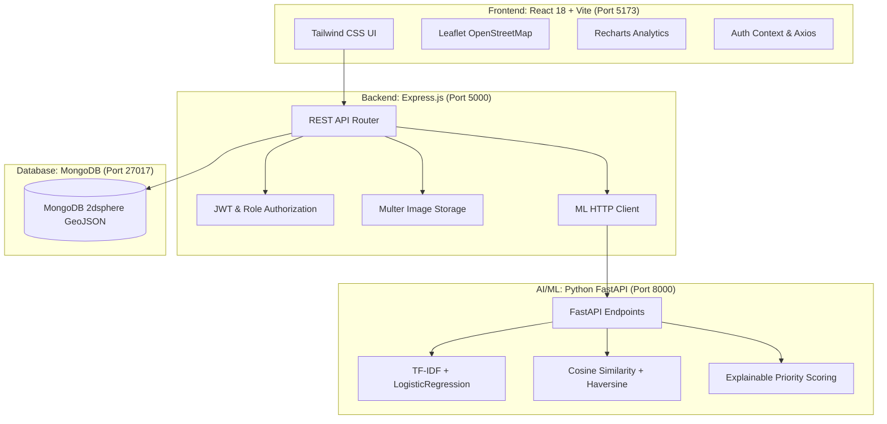

# CivicLens: AI-Powered Civic Issue Reporting, Prioritization and Resolution Tracking Platform

[](https://github.com)
[](https://github.com)
[](https://github.com)
[](https://github.com)

> **Final-Year B.Tech Computer Science Major Project**  
> Developed as a practical, demonstrable civic technology platform for municipal grievance management, explainable AI routing, dual-factor duplicate detection, and civic hotspot spatial analytics.

---

## 🌟 Executive Project Summary

**CivicLens** is an end-to-end civic issue reporting and resolution platform that bridges the gap between citizens and municipal authorities. 

Citizens can report public problems such as:
- 🚧 **Potholes and damaged roads**
- 🗑️ **Garbage accumulation and overflowing dustbins**
- 🌊 **Blocked drainage and monsoon waterlogging**
- 💡 **Broken streetlights and dangling electrical hazards**
- 🚰 **Freshwater pipeline leaks and pressure loss**
- 🚶 **Damaged footpaths and hazardous pavements**

Citizens submit complaints with descriptions, photographs, and precise geographical coordinates on an interactive OpenStreetMap interface. The system leverages an explainable Python ML service (TF-IDF + Scikit-learn) for automated category classification, geospatial duplicate detection, and transparent multi-factor priority recommendations. Field officers update status through a verified workflow and must provide resolution photographs upon completion.

---

## 🏗️ System Architecture



---

## 🚀 Key Functional Features

### 1. Citizen Portal
- **Interactive Map Pinning:** Click anywhere on Leaflet OpenStreetMap or use the "Detect My Location" button to store precise GeoJSON coordinates `[lng, lat]`.
- **Photo Upload:** Upload problem photographs up to 5MB with live preview.
- **AI Category Assistant:** One-click "Analyze with AI" predicts category and municipal division with confidence scores.
- **Unique Complaint Tracking:** Sequential IDs (e.g. `CIV-2026-0001`) with timeline history and before/after resolution proof photos.

### 2. Explainable AI / ML Microservice (FastAPI + Scikit-learn)
- **Feature 1: AI Complaint Classification:** TF-IDF n-grams (1-2) with Logistic Regression ($C=5.0$) trained on 120+ civic complaint samples, predicting category and routing department.
- **Feature 2: Dual-Factor Duplicate Detection:** Calculates TF-IDF Cosine Similarity on descriptions combined with Haversine spherical distance (< 1km) to detect clustered repeat reports without auto-deleting.
- **Feature 3: Transparent Multi-Factor Priority Recommendation:** Formulates transparent scoring based on hazard keywords (+35 pts), category baseline impact (+12 pts), clustered report volume (+10 pts per report), and SLA aging (+3 pts per day).

### 3. Special Feature: Civic Hotspot Density Analysis
- **Geospatial Clustering:** Aggregates complaints into ~500m spatial grid buckets.
- **Dynamic Leaflet Map:** Displays high-density (Red), medium (Amber), and low (Blue) concentration circles.
- **Zone Rankings & Distribution:** Ranks chronic failure hotspots with dominant problem categories and emergency alert flags.

### 4. Municipal Authority Console
- **Workload Management:** Filter assigned department complaints by category, priority, and workflow status.
- **Rigid Workflow:** Enforces `Submitted` $\rightarrow$ `Under Review` $\rightarrow$ `Assigned` $\rightarrow$ `In Progress` $\rightarrow$ `Resolved` (or `Rejected` with reason).
- **Resolution Proof:** Upload verified photographic evidence after field completion.

### 5. Municipal Administrator Console
- **KPI Metrics:** Live resolution rates, department workloads, and overdue complaint counts.
- **User & Department Management:** Activate/deactivate accounts, create field officer logins, and configure departments.
- **Reassignment & Override:** Reassign stalled complaints and override priority tiers.

---

## 👥 Demo Accounts for Viva Evaluation

The database is pre-seeded with accounts for all three roles:

| Role | Email | Password | Description |
|---|---|---|---|
| **Administrator** | `admin@civiclens.gov.in` | `Admin@123` | Master municipal console & Hotspot Analytics |
| **Authority Staff (Roads)** | `officer.roads@civiclens.gov.in` | `Staff@123` | Executive Engineer - PWD Roads |
| **Authority Staff (Sanitation)** | `officer.sanitation@civiclens.gov.in` | `Staff@123` | Chief Sanitary Inspector |
| **Authority Staff (Water)** | `officer.water@civiclens.gov.in` | `Staff@123` | Zonal Water Maintenance Lead |
| **Citizen (Aarav)** | `citizen@example.com` | `Citizen@123` | Citizen portal, report issues & track |
| **Citizen (Priya)** | `priya.sharma@example.com` | `Citizen@123` | Second citizen test account |

*(Tip: The login page has **1-Click Quick Fill Demo Buttons** for effortless presentation during your viva!)*

---

## ⚡ Quick Start Guide (Run Locally)

### 1. Prerequisites
- Node.js (v18+)
- Python (v3.10+)
- MongoDB (Running locally on `mongodb://127.0.0.1:27017` or MongoDB Atlas URI)

### 2. Setup ML Service
```bash
cd ml-service
pip install -r requirements.txt
python train.py
python -m uvicorn app:app --host 127.0.0.1 --port 8000
```

### 3. Setup Backend & Seed Database
```bash
cd server
npm install
npm run seed
node server.js
```

### 4. Setup Frontend
```bash
cd client
npm install
npm run dev
```
Open **`http://localhost:5173`** in your browser.

---

## 🧪 Automated Verification Suite

Run the full end-to-end integration test suite with:
```bash
node test_e2e.js
```
Expected result: **`ALL 10 END-TO-END VERIFICATION TESTS PASSED!`**

---

## 📚 Complete Academic Documentation (`docs/`)

The repository includes a comprehensive set of 12 academic project documents:
1. [01. Project Overview](docs/01_PROJECT_OVERVIEW.md)
2. [02. Problem Statement and Objectives](docs/02_PROBLEM_STATEMENT_AND_OBJECTIVES.md)
3. [03. Requirements Specification (SRS)](docs/03_REQUIREMENTS_SPECIFICATION.md)
4. [04. System Architecture](docs/04_SYSTEM_ARCHITECTURE.md)
5. [05. Use Case Specification & Diagram](docs/05_USE_CASE_DIAGRAM.md)
6. [06. Database ER Diagram & Schema](docs/06_DATABASE_ER_DIAGRAM.md)
7. [07. Data Flow Diagrams (DFD Level 0 & 1)](docs/07_DATA_FLOW_DIAGRAM.md)
8. [08. REST API Documentation](docs/08_API_DOCUMENTATION.md)
9. [09. Machine Learning Methodology & Evaluation](docs/09_ML_METHODOLOGY_AND_EVALUATION.md)
10. [10. Testing & Verification Report](docs/10_TESTING_REPORT.md)
11. [11. Installation & Execution Guide](docs/11_INSTALLATION_AND_EXECUTION_GUIDE.md)
12. [12. Future Scope & Roadmap](docs/12_FUTURE_SCOPE.md)

---

## 🎓 Viva Preparation & Defense Tips for CSE Students

1. **Why Scikit-learn + TF-IDF instead of BERT/LLM APIs?**
   - *Answer:* Municipal classification requires ultra-fast, explainable, lightweight processing that runs deterministically on standard municipal hardware without paid API costs or cloud latency. TF-IDF + Logistic Regression gives transparent token weights and probabilities that can be defended during external evaluation.
2. **How does duplicate detection handle slightly different citizen descriptions?**
   - *Answer:* It uses a dual-factor engine: TF-IDF Cosine Similarity handles textual variation, while the Haversine spherical formula calculates distance on GPS coordinates. Even if wording varies, a candidate within 150m sharing core civic vocabulary is flagged for authority review.
3. **How does the system ensure resolution accountability?**
   - *Answer:* Field staff cannot mark an issue "Resolved" without submitting field notes and uploading photographic verification, preserving an immutable audit trail for the citizen.

---

**Developed for Academic Evaluation • Final Year B.Tech Computer Science Engineering**
