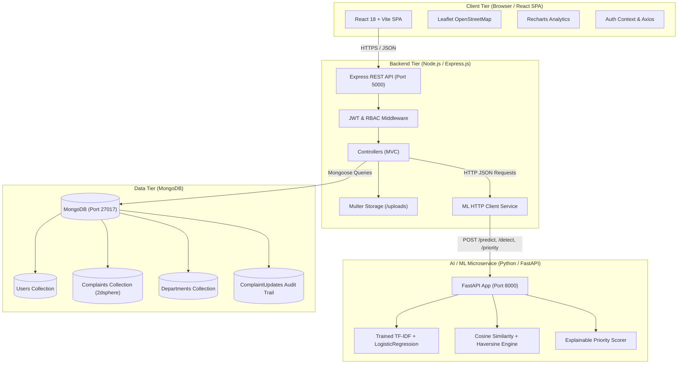

# 04. System Architecture

## 1. High-Level Architecture
CivicLens follows a decoupled, three-tier microservice architecture consisting of:
1. **Client Presentation Tier (SPA):** Built with React.js 18, Vite, Tailwind CSS, Leaflet for OpenStreetMap rendering, and Recharts for data analytics.
2. **Application & Business Logic Tier:** Built with Node.js and Express.js, providing RESTful endpoints, JWT authentication, file storage via Multer, and data models via Mongoose.
3. **Database Tier:** MongoDB Atlas or local MongoDB instance, featuring GeoJSON 2dsphere indexing for high-speed spatial proximity queries.
4. **AI / ML Microservice Tier:** Built with Python 3.14 and FastAPI, serving Scikit-learn classification pipelines, TF-IDF vectorizers, and geospatial duplicate detection logic over HTTP.

---

## 2. Architecture Diagram

---

## 3. Communication Protocols
- **Client to Backend:** HTTP REST / JSON over port 5000 with Bearer JWT tokens in the `Authorization` header.
- **Backend to ML Service:** Inter-service HTTP REST over port 8000 (`http://127.0.0.1:8000`) with JSON payloads.
- **Backend to Database:** TCP via Mongoose connection pool (`mongodb://127.0.0.1:27017/civiclens`).
