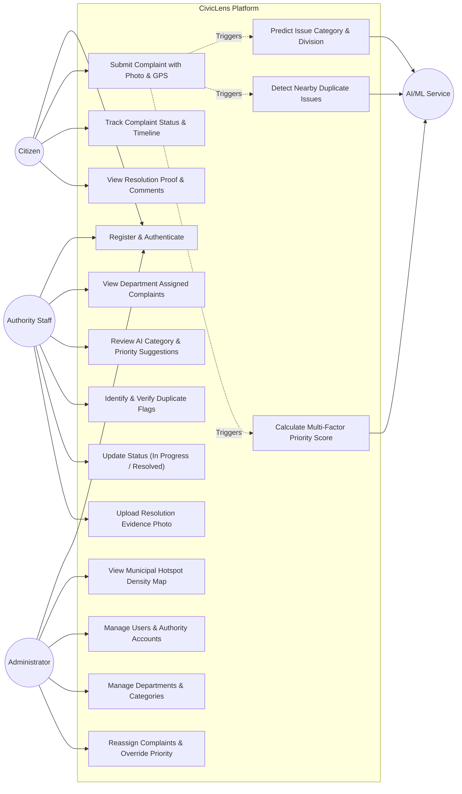

# 05. Use Case Specification & Diagram

## 1. Actors
- **Citizen:** Public user who reports civic grievances, uploads photographs, selects locations on the map, and tracks resolution progress.
- **Authority Staff (Field Officer):** Municipal department employee who inspects assigned complaints, verifies AI recommendations, advances workflow statuses, and uploads resolution evidence.
- **Administrator:** Municipal executive with city-wide privileges to manage users, configure departments, monitor civic hotspot density, and reassign stalled complaints.
- **AI / ML Service:** Autonomous computational actor that classifies complaint descriptions, flags duplicate reports, and recommends priority scores.

---

## 2. Use Case Diagram

