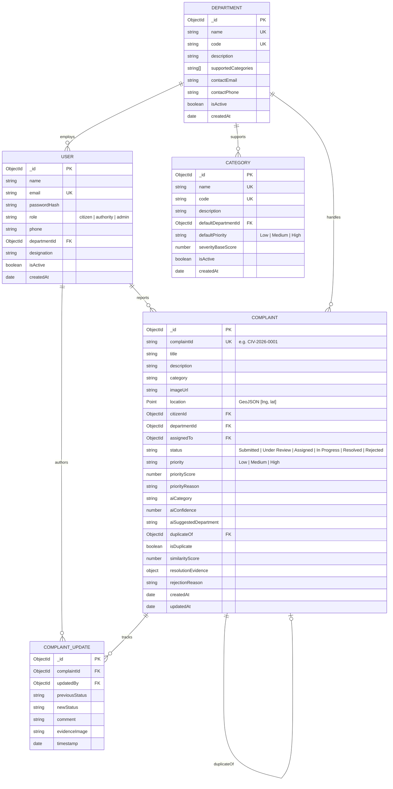

# 06. Database Schema & Entity-Relationship (ER) Diagram

## 1. Relational Entity Overview
Although MongoDB is a document-oriented NoSQL database, CivicLens maintains clean, normalized relations using Mongoose `ObjectId` references. This prevents data duplication and maintains strict integrity.

---

## 2. Entity-Relationship Diagram

---

## 3. Indexes & Constraints
1. **Complaints 2dsphere Index:** `location: '2dsphere'` allows high-speed geospatial queries (`$nearSphere` and spherical distance calculations).
2. **Sequential Unique Identifier:** `complaintId` unique index (`CIV-YYYY-XXXX`).
3. **User Email:** `email` unique index (lowercased and trimmed).
4. **Foreign Key Lookups:** Indexed `citizenId`, `departmentId`, `complaintId` on `ComplaintUpdate` to achieve sub-millisecond timeline retrieval.
