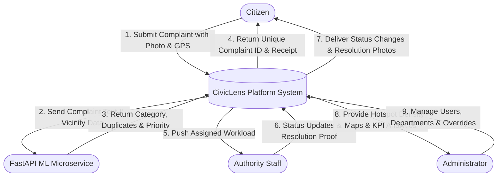

# 07. Data Flow Diagrams (DFD)

## 1. DFD Level 0 (Context Diagram)



---

## 2. DFD Level 1 (Decomposed Subsystems)

```mermaid
flowchart TD
    subgraph P1 ["Process 1: Authentication & RBAC"]
        A1["Verify JWT & Role"]
    end

    subgraph P2 ["Process 2: Complaint Ingestion & ML Routing"]
        B1["Store Multipart Photo & GPS"]
        B2["Call ML Classification Engine"]
        B3["Perform Geospatial Duplicate Check"]
        B4["Assign Department & Priority"]
    end

    subgraph P3 ["Process 3: Workflow Progression & Timeline"]
        C1["Log Status Transition"]
        C2["Verify Resolution Evidence"]
        C3["Store Audit Event"]
    end

    subgraph P4 ["Process 4: Hotspot Spatial Analytics"]
        D1["Query 2dsphere Geospatial Points"]
        D2["Compute Cluster Buckets (~500m)"]
        D3["Generate Hotspot Density Ranks"]
    end

    subgraph DB [("MongoDB Database")]
        D_Users[(Users)]
        D_Complaints[(Complaints)]
        D_Updates[(ComplaintUpdates)]
    end

    Citizen([Citizen]) -->|Submit| P1
    P1 -->|Authorized Citizen| P2
    P2 -->|Save Complaint| D_Complaints
    P2 -->|Initial Event| D_Updates

    Staff([Authority Staff]) -->|Review & Update| P1
    P1 -->|Authorized Staff| P3
    P3 -->|Update Status| D_Complaints
    P3 -->|Append Audit Event| D_Updates

    Admin([Administrator]) -->|Request Analytics| P1
    P1 -->|Authorized Admin| P4
    P4 -->|Read Geotagged Records| D_Complaints
```
